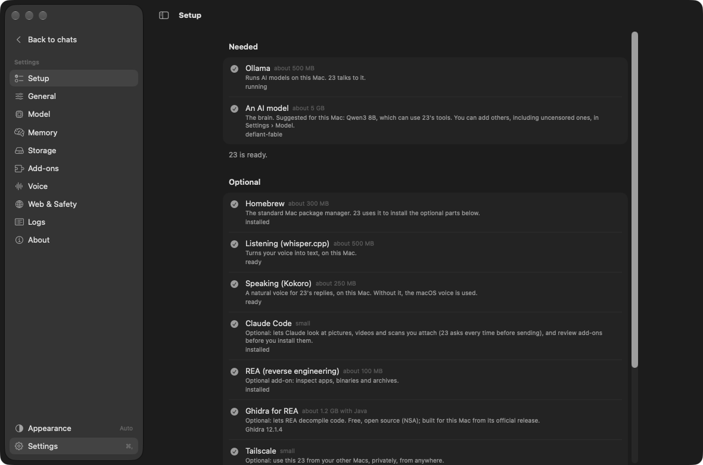
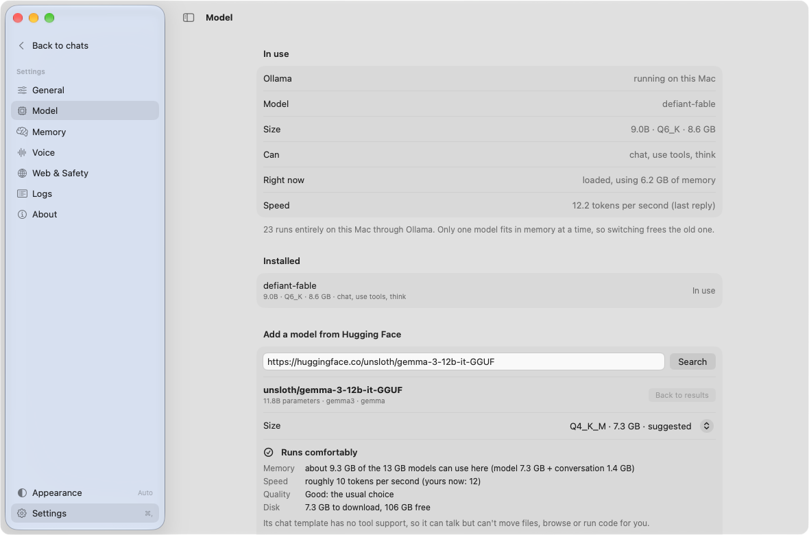
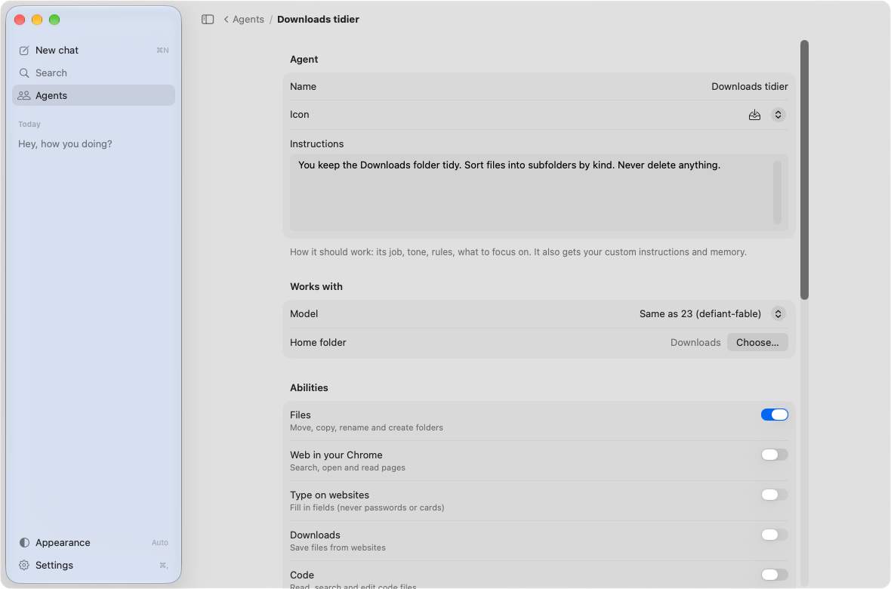
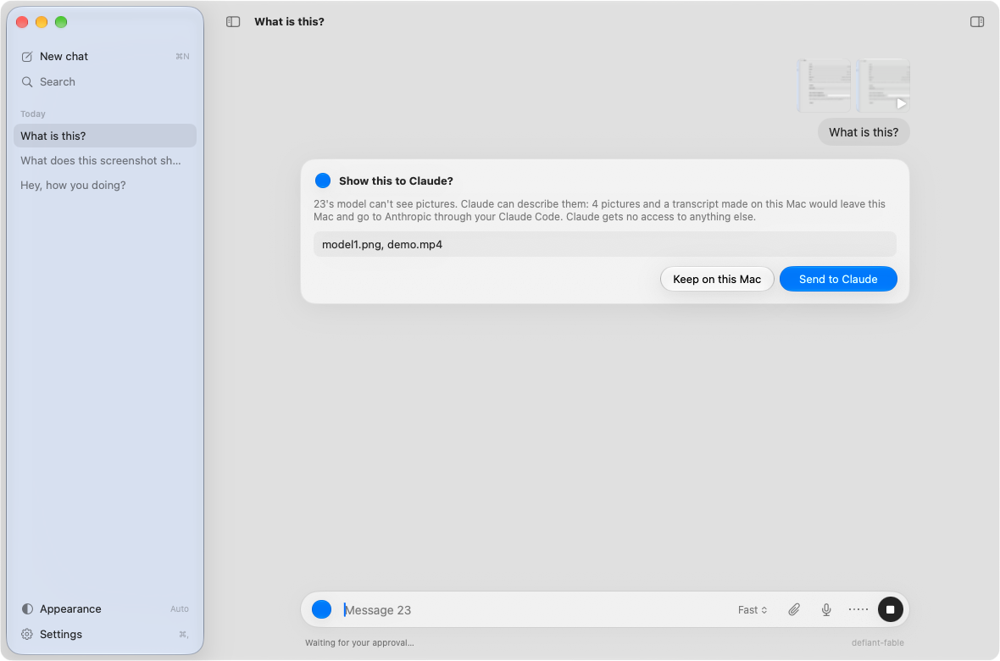

<p align="center">
  
</p>

<h1 align="center">23</h1>

<p align="center"><b>A private AI that works on your Mac, not just talks.</b><br>
Run any open model on your own computer, including uncensored ones, and let it do the job:
tidy your files, browse in your Chrome, write and run code, answer out loud.
You watch it work, and it asks before anything risky.</p>

<p align="center"><i>Free and open source (MIT). Everything runs on your Mac.</i></p>

<!-- Demo video / GIF goes here -->

### In the author's words

> This is a platform that allows you to download any AI model you want from Hugging Face and run it locally. Uncensored or abliterated models run too (GGUF), and they don't only answer questions: they have the tools to browse web pages, work with code and change files or other things on your Mac. REA (reverse engineering) and a voice package, if you'd like to talk to the AI, are one click away in Setup.

> The platform lets you create agents too. You can manage their memory and actions entirely, and the same goes for the rest of the platform. For small-RAM Macs (16 GB) the context is set to 16k; on Macs with more memory it can be raised in the code (`FitCheck.context`).

> Remote access is available too. The guardrails I've added are about the tools, to mitigate possible malicious behaviour and clicks from the model or agents: risky actions such as downloads ask for your permission, while your passwords and anything iCloud are never touched. Nothing restricts the model itself. The platform just helps you manage whatever model you run locally, with the full set of tools, skills and MCPs you can download.

> Have fun, and don't hack for evil, you're better than that.

---

## What it does

Most local AI apps are a chat window. 23 is an assistant with hands:

- **“Tidy my Downloads folder.”** It moves the files itself, and a cursor on screen shows you which file it's moving and where to.
- **“Find the cheapest flight to Tokyo next month.”** It opens your own Chrome, searches, reads the pages and reports back. It never types passwords or card numbers.
- **“Make this script print 15 numbers and run it.”** It edits the code, shows you the diff and runs it in a sandbox. You can undo any change.
- **“What's in this screenshot?”** Attach files, screenshots, PDFs or videos. Text is read on your Mac. Pictures can be shown to Claude, but 23 asks you every time first.
- **Talk to it.** Hold ⌃⌥Space, or click the menu-bar icon, and it answers out loud with a natural voice. Both run on your Mac.

## Why it's different

- **Any model, your rules.** Download models from Hugging Face inside the app. Before you download, 23 checks whether the model will run well on your Mac: memory, speed, disk space, and whether it can use tools.
- **It does the work.** Files, Chrome, code, commands, memory, agents that run on a schedule, and add-ons (MCP servers, skills, reverse engineering with REA and Ghidra).
- **Safe by design.** Approvals for anything that changes or sends something, a sandbox for code and add-ons, undo, and a log of everything it did. Your iCloud and Apple Account data is completely off limits. Details below.
- **Private.** The model runs on your Mac. Nothing goes to the cloud unless you make it: the websites you ask it to visit, models you download, and Claude, only when you approve.
- **Use it from your other Macs.** Your MacBook can be a remote for the Mac that runs 23 (over [Tailscale](https://tailscale.com)), with the same chats and its own microphone and speakers.

## Screenshots

| | |
|---|---|
|  |  |
| **Setup** checks what's installed and installs the rest with one click. | **Add a model** from Hugging Face, with a check of whether it will run well first. |
|  |  |
| **Agents** have their own instructions, folder and abilities, and can run on a schedule. | **Nothing leaves your Mac** without asking first. |

## Requirements

- A Mac with **Apple silicon** (M1 or later) and **macOS 26** or later.
- **16 GB of memory** recommended (8 GB works with a smaller model).
- About **10 GB free** for a model, plus up to 2 GB for the optional voice and add-ons.

## Install

1. Download `23.zip` from [Releases](../../releases), unzip it and move **23** to Applications.
2. Open it. macOS will say it can't check the app, because 23 isn't signed with a paid Apple developer certificate (it's a free project). Go to **System Settings › Privacy & Security**, scroll down and click **Open Anyway**. You only do this once.
3. 23 opens **Setup**. It needs two things, both with an install button:
   - **[Ollama](https://ollama.com)**, which runs AI models on your Mac.
   - **A model.** 23 suggests one sized for your Mac (Qwen3 4B, 8B or 14B, which can use 23's tools). You can add others later, including uncensored ones, in **Settings › Model**.
4. Optional extras, each explained in Setup with an install button and instructions for doing it by hand:

   | | What it adds | Comes from |
   |---|---|---|
   | Homebrew | Installs the parts below | [brew.sh](https://brew.sh) (its installer asks for your password in Terminal) |
   | Listening | Voice input | [whisper.cpp](https://github.com/ggml-org/whisper.cpp) and its `ggml-small.en` model |
   | Speaking | A natural voice | [Kokoro](https://github.com/thewh1teagle/kokoro-onnx) |
   | Claude Code | Claude looks at pictures you attach, and reviews add-ons | [claude.com/claude-code](https://claude.com/claude-code) |
   | REA + Ghidra | Reverse engineering apps and binaries | [REA](https://github.com/morluto/rea), [Ghidra](https://github.com/NationalSecurityAgency/ghidra) |
   | Tailscale | Use 23 from your other Macs | [tailscale.com](https://tailscale.com/download/mac) |

   Every download is checked against a known SHA-256 checksum, and a file that doesn't match is deleted, never used.

5. Allow **Accessibility** (so it can show its cursor and use Chrome) and the **microphone** when macOS asks.

### Build it yourself

You need Xcode or its Command Line Tools.

```sh
git clone https://github.com/ignaschwartz-lgtm/23-uncensored-local-ai-platform.git && cd 23-uncensored-local-ai-platform
./build.sh             # builds, signs ad-hoc and installs /Applications/23.app
scripts/package.sh     # or: builds a release zip in build/23.zip without installing
```

If you create a code-signing certificate called **“23 Local Signing”** in Keychain Access, `build.sh` uses it, and macOS then keeps 23's permissions between rebuilds.

## Safety

23 can act on your Mac, so it's built to be careful:

- **Approvals.** It asks before it deletes anything (even to the Bin), sends or submits on a website, downloads, runs a risky command, installs something, sends anything to Claude, or acts on something it read on a web page. Each request shows exactly what will happen.
- **iCloud and Apple Account: never.** iCloud Drive, Photos, Mail, Messages, Notes, Keychains and similar are blocked for every tool, command and add-on, with no exceptions.
- **A sandbox for code and add-ons.** Commands and add-on servers run in a macOS sandbox. They can only write to their own folder, temp and caches. They have no access to iCloud, your keychain or SSH keys, and no internet unless you allow it.
- **Private fields stay private.** It never types passwords, card numbers or one-time codes. You do that yourself.
- **Website rules.** Mark sites as *trusted* or *protected*; on protected sites, every click and keystroke asks first.
- **What it reads isn't an instruction.** Text from web pages, files and add-ons is treated as information, never as commands, and actions after reading it ask first.
- **Undo and a log.** File moves, renames, code edits and memory changes can be undone. Everything it does is written to `~/Library/Logs/23-activity.log`.
- **Agents can only narrow.** An agent's abilities can be fewer than 23's, never more. When an agent running by itself needs your OK, it waits and notifies you.
- **Add-ons are reviewed before install.** They're downloaded with install scripts switched off, and Claude reads the code and reports what it does and any red flags before you decide.

## What leaves your Mac

| When | What | Where |
|---|---|---|
| You ask it to browse | The pages it opens | Those websites, in your Chrome |
| You download a model or add-on | The download request | Hugging Face, npm, GitHub, the MCP Registry |
| You approve sending an attachment or reviewing an add-on | That picture or that add-on's code | Anthropic, through your own Claude Code |
| You use a remote Mac | Your chats, between your own Macs | Over your Tailscale network only |

Nothing else. The model, your files, your memory and your chats stay on your Mac.

## A note on models

23 runs whatever model you choose, including uncensored ones. What you do with it is up to you and your local laws, and each model comes with its own licence, shown on its Hugging Face page. Small local models are good at using tools, but can get reasoning and maths wrong. For numbers, ask it to “calculate it with Python”.

## How it's built

A native macOS app in Swift (SwiftUI and AppKit), about 14,000 lines with no third-party Swift packages. It uses:

- **[Ollama](https://ollama.com)** for the model, with tool calling and a 16k context. A meter in each chat shows how full it is, and you can compact older messages into a summary.
- **The Accessibility API** to find real Finder icons and Chrome elements, which is how the on-screen cursor knows where to go.
- **`sandbox-exec`** (Seatbelt) profiles for commands and add-ons.
- **[whisper.cpp](https://github.com/ggml-org/whisper.cpp)** and **[Kokoro](https://github.com/thewh1teagle/kokoro-onnx)** for voice, both started on demand.
- **MCP** (Model Context Protocol) for add-ons. Large servers such as REA, with 207 tools, are reached through two small tools (“find a tool”, “use a tool”) so a small model's context isn't flooded.
- **A small HTTP server bound to the Tailscale address only**, for remote use.

`Sources/TwentyThree` holds everything. Good places to start are `ChatModel.swift` (the agent loop), `PathPolicy.swift` (the safety rules), `FileTools.swift`, `BrowserTools.swift` and `CodeTools.swift` (the tools), and `MainWindow.swift` (the UI).

**Self-test:** `.build/release/TwentyThree --selftest` runs over 200 checks, including the real sandbox behaviour.

## Contributing

Issues and pull requests are welcome. Some useful directions:

- More models tested with tools, and better defaults for smaller Macs.
- Intel Mac support, and older macOS versions.
- Accessibility (VoiceOver), and translations.
- Making Setup smoother on a fresh Mac. If something didn't work for you, please open an issue with the Setup log (the ≡ button next to each item).

Please keep the safety rules intact. A change that makes 23 more capable should still ask before anything risky.

## Credits

23 stands on these open-source projects: [Ollama](https://ollama.com) and [llama.cpp](https://github.com/ggml-org/llama.cpp), [whisper.cpp](https://github.com/ggml-org/whisper.cpp), [Kokoro](https://huggingface.co/hexgrad/Kokoro-82M) via [kokoro-onnx](https://github.com/thewh1teagle/kokoro-onnx), [REA](https://github.com/morluto/rea) (MIT), [Ghidra](https://github.com/NationalSecurityAgency/ghidra) (Apache 2.0), [Qwen](https://huggingface.co/Qwen) models, and [Tailscale](https://tailscale.com). Each keeps its own licence.

## Licence

MIT. See [LICENSE](LICENSE).
